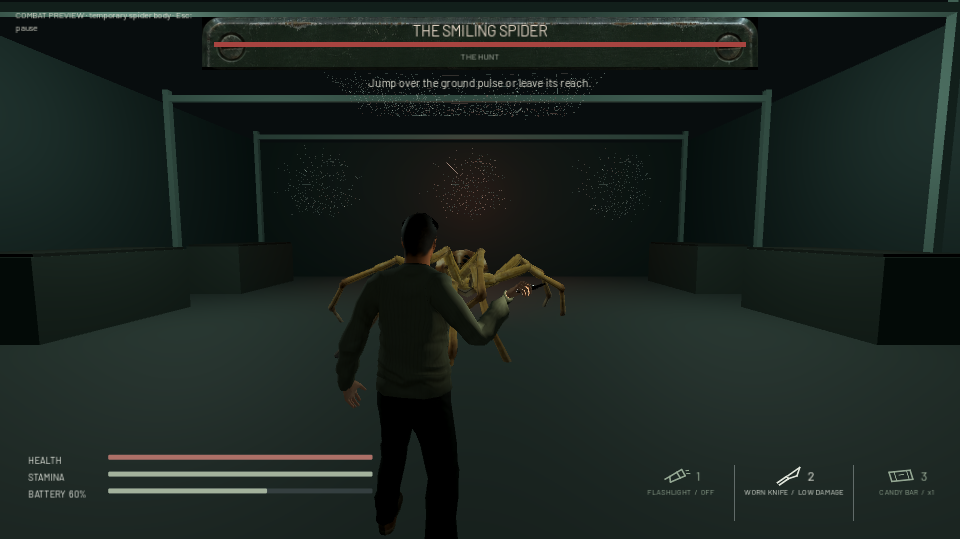

# Smiling Spider combat preview

Open **Extras → Boss combat preview**. This is a separate test encounter and does not advance or replace the tutorial save. The approved crown model is still unavailable for export through Meshy. The preview therefore uses the existing recovered, rigged spider, clearly labelled as temporary. It does not contain the approved grin or four stone portraits.

## Six attacks

The prototype boss has **120 HP**. The worn knife keeps its existing **4 damage**, so a kill needs 30 successful hits. Below 60 HP, ground slam and marked leap join the attack sequence. The final story encounter and capture remain separate production work.

| Attack | Tell / active / recovery | Damage | Animation and counter |
|---|---|---:|---|
| Fang rush | 1.10 / 0.65 / 1.55 s | 14 | Head lowers, front legs tuck, then a straight charge. Sidestep; direction is committed at the tell. |
| Reaping sweep | 1.25 / 0.65 / 1.70 s | 12 | One front leg rises and sweeps across the front. Crouch underneath or leave its reach. |
| Double bite | 0.90 / 1.20 / 1.65 s | 9 each | Pedipalps spread; two fang closures with recoil between. Wait for both before closing in. |
| Silk spit | 1.30 / 0.45 / 1.60 s | 6 | Abdomen contracts and head throws forward; one visible silk projectile. Sidestep; contact slows movement to 65% for 1.6 seconds. |
| Ground slam | 1.60 / 0.50 / 1.90 s | 16 | Both forelegs lift, then strike the floor. Jump above the pulse or leave the 3.8 m reach. |
| Marked leap | 1.55 / 0.90 / 2.10 s | 18 | Legs fold, body springs, legs spread on landing. Leave the marked spot; its target locks before takeoff. |

All six are authored skeletal AnimationPlayer clips on the existing 142-bone spider rig. They are not PINOC output or animations for the unavailable Meshy mesh. They need a further rigging/retargeting pass once that mesh is exported. Contact windows follow the same physics timeline as their animations; one damage token per swing prevents frame-by-frame damage, while double bite has two separate tokens. World geometry blocks melee/projectile contact. Pause, restart, defeat and player recovery cancel or freeze the relevant attacks.

## Interface and sound

- Top-center named health bar appears when combat begins, with a delayed damage trail and a second-phase label. It clears on retry and fades after defeat.
- Brief counter hints accompany tells. The ground marker shows the committed leap destination.
- Five voiced lines cover Luke's arrival, the boss greeting, Mica's warning, the phase change and Luke's victory. Captions follow actual audio playback; lines queue rather than overlap. Pause pauses speech, and retry/defeat clear stale queued lines.
- Voices use existing local Kokoro stock synthetic voices, not human actors or cloned voices. Sources, exact text, durations and hashes are in `Godot/data/boss_voice.json`.
- I opens inventory. Esc pauses, resumes, retries or returns to the main menu. Preview inventory resets separately from the house campaign.

## Provider checks and remaining model work

Meshy task `01a1b5b9-46d3-74dd-9f3a-b7aa1c8c81f1` remains succeeded but returns no download formats. No credits were spent generating a duplicate. PINOC's curated library has human-skeleton clips and the user's motion library search returned no arachnid attack. No incompatible humanoid motion was purchased or described as a spider animation.

Remaining for the approved model: obtain a supported GLB/FBX export, inspect geometry/UVs, rig eight legs plus fangs and abdomen, transfer and refine all six animations, fit hit volumes to the actual mesh, and repeat the encounter tests. A static image or encrypted viewer file is not an importable replacement.

Implementation references: [Godot AnimationPlayer](https://docs.godotengine.org/en/stable/classes/class_animationplayer.html), [ShapeCast3D](https://docs.godotengine.org/en/stable/classes/class_shapecast3d.html). Provider capabilities were checked through the connected Meshy and PINOC tools.

## Validation

- Boss integration: 58 checks, including actual skeletal pose movement, damage windows/tokens, cover, crouch/jump counters, pause, restart, phase change, health bar and audio queue.
- Player survival: 67 checks; the old fixture's knife contact sample was corrected from 0.25 s to cross the existing 0.28 s hit event. Production knife timing was not changed.
- Menu rendering: 23 checks.
- Isolated portable PCK: 85 checks, including the complete house startup and new boss scene, six clips, health bar and all five voice files. The Extras button also passed a native rendered visibility/bounds check.
- Updated portable package installed successfully; tutorial save/configuration hashes were identical before and after replacement. The active project remains below 5,000,000,000 bytes.
- Native graphics playthrough completed all six attacks on Radeon RX550/550 Series at 960×540. 1,354 sampled frames averaged 16.64 ms; p95 was 17.45 ms. This is a bounded automated preview measurement, not a full gameplay performance guarantee.
- All five voice clips passed signal checks (0 clipped samples) and local speech recognition recovered their intended wording, apart from punctuation and contraction normalization. Perceived voice quality remains a creative review item.

`Tools/Assets/generate_boss_voice.mjs` can regenerate the audio using the separate Kokoro JS authoring runtime at `D:/BlackwebVoiceScratch` (override with `BLACKWEB_VOICE_RUNTIME`). Only the resulting WAVs and metadata ship. Previous QA evidence was archived to `D:/CodexTemp/Blackweb-BossPass/PriorEvidence` to keep the active project under 5 GB.
