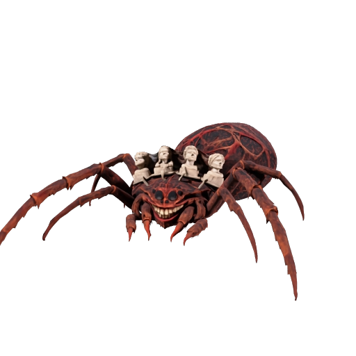

# The Smiling Spider: playable Blender model

The game now uses an editable, locally authored GLB with eight articulated legs, a tooth-lined grin, four intact stone portrait sculptures, nine material surfaces and a 31-bone skeleton. Its nine embedded clips cover idle, walk, collapse and six attacks. This is an independent interpretation of the approved concept; it is not an export of the Meshy draft.

Runtime asset: `Godot/assets/generated/smiling_spider/smiling_spider.glb`. Editable master: `D:/GameProjects/Blackweb-BossWorkshop/SmilingSpider-v2/smiling_spider_final.blend`. The Blender builder, material pass and motion rebake scripts are under `Tools/Assets`; see the asset README for their order. The four sculpture faces adapt the project's MIT Microsoft Rocketbox mesh. The chitin albedo was created with built-in imagegen, with the source and exact prompt retained under `Tools/Assets/References/SmilingSpiderChitin.*`.

This is a real rigged game asset and a substantial prototype art pass. It is not represented as finished AAA production art. The body detailing, bust likenesses and cinematic finish remain open to further art direction. See [the outdoor encounter](SmilingSpiderCombat.md) for controls and validation.

## Earlier Meshy draft record

Meshy completed a textured 3D draft on 2026-11-07 from the approved crown concept. It can be viewed through Meshy's model card. **No downloadable formats were returned by the connection, so that specific Meshy draft is not installed in the game.** No encrypted viewer data was used in the locally authored replacement above.

The generated preview preserves the spider silhouette, toothy grin and four pale stone portrait busts. It remains a first draft: the thumbnail does not establish final anatomy, topology, UV quality, material quality, or rig suitability. A local geometry inspection and detailed model review are still required after an export becomes available. No rig or animation was requested or created.

## Generation record

- Task: `01a1b5b9-46d3-74dd-9f3a-b7aa1c8c81f1` (`image-to-3d`)
- Status: `SUCCEEDED`, 100%.
- Geometry: `meshy-t2.5`; requested target: 30,000 triangles, not independently verified.
- Texture: `meshy-n1`, base-color output; no PBR claim.
- Balance observed before / after: 76 / 61 credits.
- Source: [approved crown concept](Design/smiling-spider-crown-v3.png).
- Prepared image: [isolated reference](Design/smiling-spider-model-v1-reference.png), created with built-in imagegen. See [exact prompt](Design/SmilingSpiderModelV1ReferencePrompt.txt).
- Standalone local workshop: `D:\GameProjects\Blackweb-BossWorkshop\SmilingSpider-v1`. This contains the reference, provider thumbnail, prompt and generation record, not a mesh file.

PINOC's character library search found no spider match. Its generated characters use Gaussian splats, so no character generation was submitted for this conventional mesh request. Higgsfield's Tripo P2 route quoted 34 credits against an available balance of 1.7; no generation or trial activation was submitted there.

For a future handoff, retrieve this existing Meshy task rather than generating and paying again. Check its returned download formats. If GLB becomes available, download it through the supported tool, inspect the actual geometry in Blender, verify all eight legs and four separate stone busts, and review texture/UV quality before planning rigging. Do not treat an encrypted viewer file as a model export.
